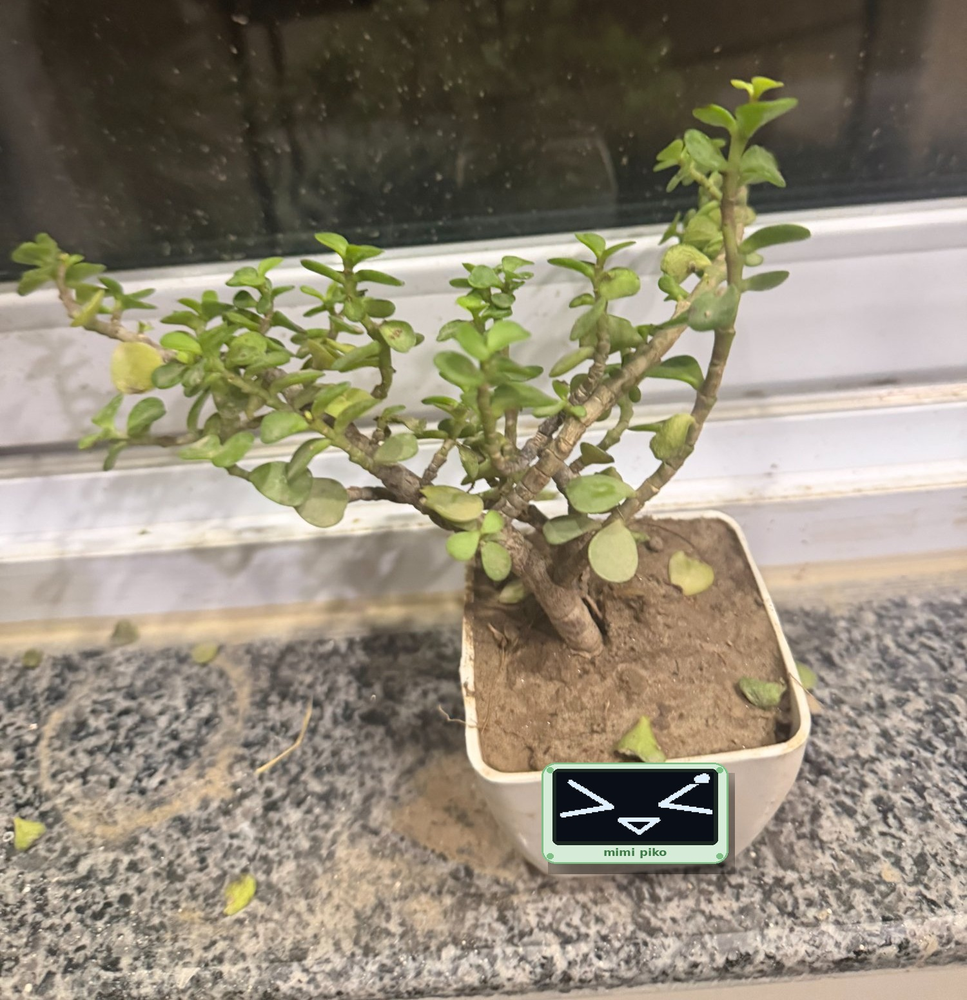
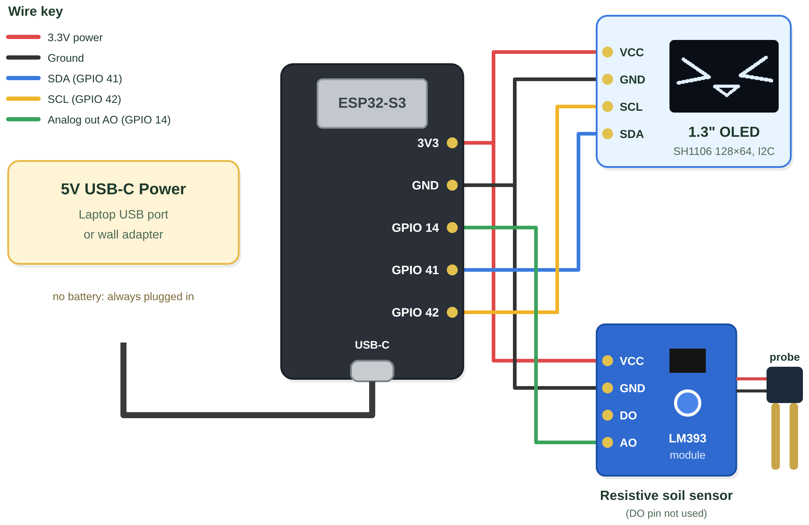
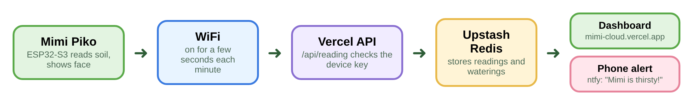
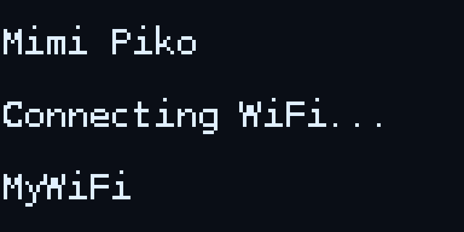
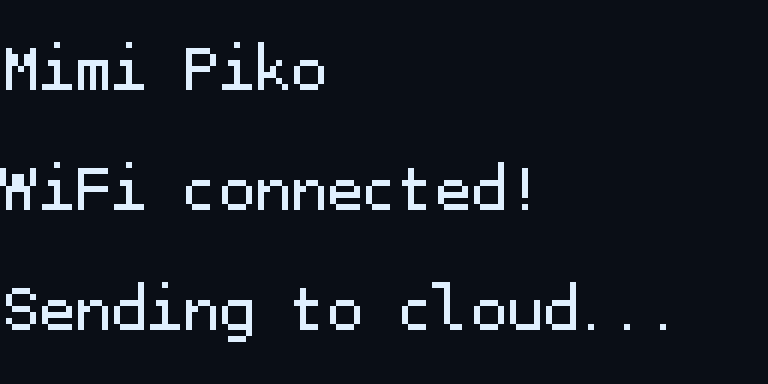
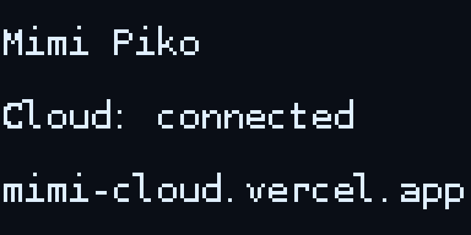
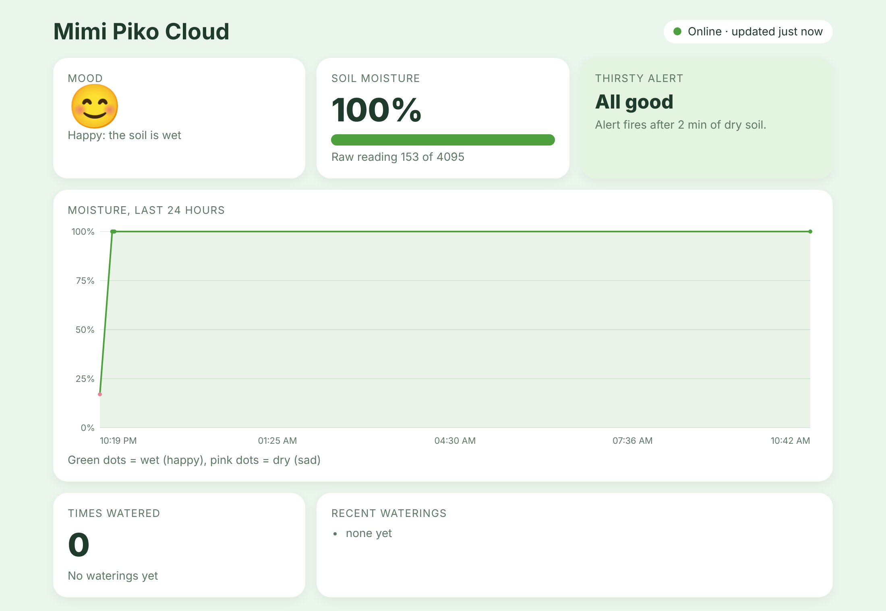

# Mimi Piko

A smart plant pot that shows how its plant feels. When the soil is dry, Mimi shows a sad face. After watering, she smiles. The cloud version also uploads every reading to a live dashboard and sends a phone alert when the plant is thirsty.

## Links

| | |
|---|---|
| 🌐 **Live website (Vercel)** | https://mimi-cloud.vercel.app |
| 🎬 **Demo video** | [Watch on Google Drive](https://drive.google.com/file/d/1QN0ekdOgvn3DvWlxUio47j1cAtSOwYAu/view?usp=drivesdk) |
| 📊 **Presentation** | [Mimi_Piko_Final_Presentation.pptx](docs/Mimi_Piko_Final_Presentation.pptx) · [first presentation](docs/Mimi_Piko_Presentation.pptx) |
| 📄 **Cloud showcase** | [Mimi_Piko_Cloud_Showcase.docx](docs/Mimi_Piko_Cloud_Showcase.docx) |
| 💻 **Code** | [Cloud firmware](firmware/Mimi_Piko_Cloud/Mimi_Piko_Cloud.ino) · [Offline firmware](firmware/Mimi_Piko_Offline/Mimi_Piko_Offline.ino) · [Website + API](cloud/) |



Cloud Computing semester project, Department of Software Engineering, MUET Jamshoro
Instructor: Dr Rabeea Jaffari

| Team member | Roll number |
|---|---|
| Muhammad Umair | 22SW164 |
| Muhammad Ahmed | 22SW161 |
| Huzaifa Abbasi | 22-21SW161 |

## Hardware

Three parts, powered by a USB-C cable from a laptop or wall adapter:

- **ESP32-S3** microcontroller
- **1.3" OLED** display (SH1106, 128 × 64, I2C)
- **Resistive soil moisture sensor** (probe + blue LM393 board)

Only the probe goes into the soil. The screen sits in a plastic case on the front of the pot and the ESP32-S3 in a case on the back, so no electronics touch water.

| Part | Pin | ESP32-S3 |
|---|---|---|
| OLED | VCC / GND | 3V3 / GND |
| OLED | SDA | GPIO 41 |
| OLED | SCL | GPIO 42 |
| Soil sensor | VCC / GND | 3V3 / GND |
| Soil sensor | AO (analog out) | GPIO 14 |
| Soil sensor | DO | not used |



## How it works

1. The probe's resistance drops when the soil is wet. The LM393 board turns that into a voltage on AO.
2. The ESP32-S3's 12-bit ADC reads it as a number from 0 to 4095. **Higher means drier.**
3. A reading of **2500 or more** means dry, so Mimi shows the sad face. Below 2500 she plays a 98-frame happy animation.

| Dry soil | Wet soil |
|---|---|
|  |  |

## Cloud version

```
Mimi Piko (ESP32-S3) → WiFi → Vercel API → Upstash Redis → Dashboard + phone alert (ntfy)
```



- Once a minute Mimi turns WiFi on, sends the raw reading, moisture %, mood and any new waterings to `/api/reading`, then turns WiFi off again. GPIO 14 is an ADC2 pin and can't be read while WiFi is on, which is why WiFi is only on for a few seconds.
- Waterings are detected automatically when moisture rises by 15% or more within 4 minutes.
- The Vercel API stores the last 24 hours of readings and the last 100 waterings in Upstash Redis.
- If the soil stays dry for a set time, the cloud sends a "Mimi is thirsty!" notification through ntfy.

| Connecting | Connected | Cloud |
|---|---|---|
|  |  |  |



## Repository layout

```
firmware/
  Mimi_Piko_Offline/          Original version: faces only, no WiFi
  Mimi_Piko_Cloud/            Cloud version: faces + uploads to Vercel
  experimental/Mimi_Piko_Hotspot/   Own WiFi hotspot + portal (needs AO on GPIO 4)
cloud/                        Vercel project: API + dashboard (see cloud/README.md)
docs/                         Presentations and the cloud showcase document
images/                       Renders, diagrams, OLED screens, photos
```

## Flashing the firmware

1. Install **esp32 by Espressif Systems** (3.x) in Boards Manager and **U8g2** in Library Manager.
2. Open the `.ino` inside its folder (Arduino needs the folder name to match the file name).
3. Tools settings: Board **ESP32S3 Dev Module**, Partition Scheme **Huge APP (3MB No OTA/1MB SPIFFS)**, PSRAM **Disabled**, USB CDC On Boot **Enabled**.
4. For the cloud version, set `WIFI_SSID`, `WIFI_PASS`, `CLOUD_URL` and `DEVICE_KEY` at the top of the file first.
5. Serial Monitor at 115200 shows the raw readings. Use them to adjust `SOIL_DRY_THRESHOLD` for your soil.

## Deploying the cloud

See [cloud/README.md](cloud/README.md). In short: `npx vercel --prod` from the `cloud` folder, add Upstash Redis from the Vercel Storage tab, and set `DEVICE_KEY`, `NTFY_TOPIC` and `ALERT_AFTER_MIN` as environment variables.
